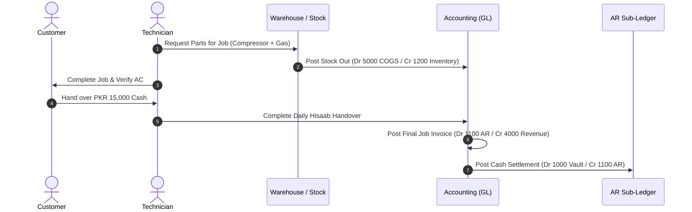
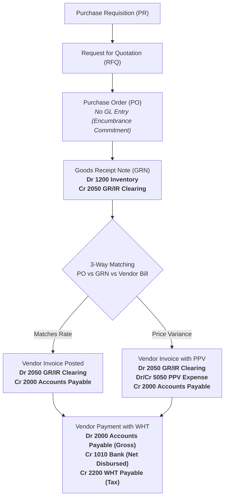
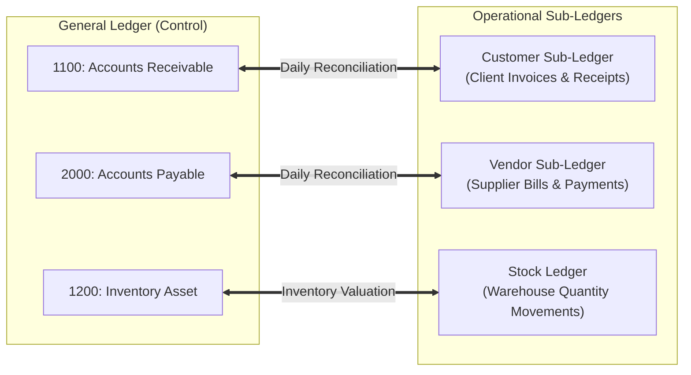

# Workman Services ERP — Complete Chart of Accounts & Dynamic Transaction Mapping Specification

**Document Version:** 2.0  
**Effective Date:** October 2026  
**Audience:** Accountants, Financial Auditors, System Architects, Storekeepers, and Operations Managers  
**Target Repository:** `Workman Services ERP` (`D:\WORKMAN SERVICES`)  
**Core Accounting Services:** [`AccountMappingService.ts`](file:///d:/WORKMAN%20SERVICES/src/lib/services/AccountMappingService.ts), [`AccountsPostingService.ts`](file:///d:/WORKMAN%20SERVICES/src/lib/services/AccountsPostingService.ts)

---

## Table of Contents

1. [Executive Financial Architecture](#1-executive-financial-architecture)
2. [Complete Chart of Accounts (COA) Directory](#2-complete-chart-of-accounts-coa-directory)
   - [Level 1–3 Category Hierarchy](#21-level-13-category-hierarchy)
   - [Level 4 Transactional Posting Accounts](#22-level-4-transactional-posting-accounts)
3. [Dynamic Account Mapping Architecture](#3-dynamic-account-mapping-architecture)
   - [The Resolution Protocol (`AccountMappingService`)](#31-the-resolution-protocol-accountmappingservice)
   - [Master Mapping Registry (Transaction Types to GL Accounts)](#32-master-mapping-registry-transaction-types-to-gl-accounts)
4. [Exhaustive Transaction Posting Matrix (Small to Big)](#4-exhaustive-transaction-posting-matrix-small-to-big)
   - [A. Jobs, Field Operations & Customer Billing](#41-a-jobs-field-operations--customer-billing)
   - [B. Inventory, Parts Dispatch & Warehouse Stock](#42-b-inventory-parts-dispatch--warehouse-stock)
   - [C. Procurement, Supply Chain & Accounts Payable (3-Way Match)](#43-c-procurement-supply-chain--accounts-payable-3-way-match)
   - [D. Point of Sale (POS) Counter Operations](#44-d-point-of-sale-pos-counter-operations)
   - [E. Human Resources, Payroll & Technician Hisaab](#45-e-human-resources-payroll--technician-hisaab)
   - [F. Banking, General Expenses & Facility Overheads](#46-f-banking-general-expenses--facility-overheads)
   - [G. Fixed Assets, Depreciation & Fiscal Period Close](#47-g-fixed-assets-depreciation--fiscal-period-close)
5. [Sub-Ledger Integration & Reconciliation Rules](#5-sub-ledger-integration--reconciliation-rules)
6. [Pakistani Statutory Tax Compliance & FBR Rules](#6-pakistani-statutory-tax-compliance--fbr-rules)

---

## 1. Executive Financial Architecture

Workman Services ERP utilizes an **append-only, immutable double-entry general ledger** governed by mathematical invariant:
$$\sum \text{Debits} = \sum \text{Credits}$$

### Core Architecture Principles:

1. **Decoupled Dynamic Mapping**: Operational workflows (Jobs, Warehouse, POS, Procurement, Payroll) **never hardcode GL account numbers**. Instead, every subsystem requests a standardized *Accounting Role* (e.g. `job_revenue_receivable`, `grn_receipt_clearing`, `vendor_payment_wht`) from [`AccountMappingService`](file:///d:/WORKMAN%20SERVICES/src/lib/services/AccountMappingService.ts).
2. **Immutable Journal Entries**: Once an accounting journal (`JournalEntry`) is posted, it is never modified or deleted. Any corrections or adjustments require an equal-and-opposite *Reversal Entry* created via `AccountsPostingService.reverseEntry()`, leaving an untampered audit trail.
3. **Four Interlocking Ledgers**:
   - **General Ledger (GL)**: Financial source of truth comprising balanced debits and credits across assets, liabilities, equity, revenues, and expenses.
   - **Customer & Vendor Sub-Ledgers**: Entity-level running ledgers (`CustomerLedgerEntry`, `VendorLedgerEntry`) reconciled against GL control accounts (`1100 AR`, `2000 AP`).
   - **Technician Ledger**: Real-time record of technician advances, daily field cash collections, reimbursable expenses, and payroll deductions.
   - **Stock Ledger**: Physical stock movement tracking (IN, OUT, TRANSIT, RETURN) matched to financial Inventory Asset valuations (`1200`).
4. **Period Lock Enforcement**: Closed accounting periods prevent backdated entries, ensuring tax reporting and audited statements cannot be corrupted.

---

## 2. Complete Chart of Accounts (COA) Directory

The Chart of Accounts follows a standard 4-digit numbering scheme organized across a 4-level taxonomy:
- **Level 1 (Category Groups - 1000s to 6000s)**: High-level balance sheet and P&L categories.
- **Level 2 (Sub-Categories - 1100s, 1200s, etc.)**: Major operational segments.
- **Level 3 (Control Summary Accounts)**: Aggregation nodes for reporting.
- **Level 4 (Posting / Leaf Accounts)**: Concrete operational accounts where all transactions are recorded.

---

### 2.1 Level 1–3 Category Hierarchy

```mermaid
graph TD
    COA["Chart of Accounts Root"] --> A["1000-GRP: Assets"]
    COA --> L["2000-GRP: Liabilities"]
    COA --> E["3000-GRP: Equity & Capital"]
    COA --> R["4000-GRP: Revenue & Income"]
    COA --> C["5000-GRP: Cost of Goods Sold"]
    COA --> O["6000-GRP: Operating Expenses"]

    A --> A1["1100-GRP: Current Assets"]
    A --> A2["1200-GRP: Non-Current / Fixed Assets"]
    A1 --> A11["1110: Cash & Cash Equivalents"]
    A1 --> A12["1120: Trade Receivables"]
    A1 --> A13["1130: Inventories & Consumable Stock"]
    A1 --> A14["1140: Advances, Deposits & Prepayments"]
    A2 --> A21["1210: Service Equipment, Vehicles & Tools"]

    L --> L1["2100-GRP: Current Liabilities"]
    L1 --> L11["2110: Trade Payables"]
    L1 --> L12["2120: Technician & Staff Liabilities"]
    L1 --> L13["2130: Statutory Tax Liabilities"]
    L1 --> L14["2140: Procurement Clearing Accounts"]

    E --> E1["3100: Owners' Capital & Reserves"]
    E1 --> E11["3110: Contributed Capital & Drawings"]
    E1 --> E12["3120: Accumulated Reserves"]

    R --> R1["4100-GRP: Operating Revenue"]
    R1 --> R11["4110: HVAC Services & Installation Billing"]
    R1 --> R12["4120: Sales Discounts & Allowances (Contra)"]

    C --> C1["5100: Direct Materials & Parts Consumed"]
    C1 --> C11["5110: HVAC Parts & Gas Consumption"]
    C1 --> C12["5120: Procurement Price Variances"]

    O --> O1["6100-GRP: Salaries, Wages & Staff Benefits"]
    O --> O2["6200-GRP: Field Operations & Fleet Expenses"]
    O --> O3["6300-GRP: Administrative & Facility Overheads"]
    O --> O4["6400-GRP: Depreciation & Asset Amortization"]
```



---

### 2.2 Level 4 Transactional Posting Accounts

All postings must hit an active **Level 4** account. The table below represents every active account in the Workman Services ERP:

| Code | Account Title | Level | Normal Balance | Classification | Description & Functional Scope |
| :--- | :--- | :---: | :---: | :--- | :--- |
| **`1000`** | **Cash on Hand / Main Drawer** | 4 | Debit | Current Asset | Physical currency in the central office safe, cashier counter, and technician field collection surrender vault. |
| **`1010`** | **Operating Bank (Meezan Bank)** | 4 | Debit | Current Asset | Primary corporate Islamic banking account for client bank transfers, supplier disbursements, and staff payroll. |
| **`1011`** | **Secondary Bank Account (HBL)** | 4 | Debit | Current Asset | Secondary corporate collections account used for alternate client deposits and vendor settlement transfers. |
| **`1020`** | **Petty Cash Float** | 4 | Debit | Current Asset | Imprest float maintained for emergency office supplies, courier charges, and minor incidental field expenses. |
| **`1100`** | **Accounts Receivable (Trade Clients)** | 4 | Debit | Current Asset | Master control account representing billable claims due from direct residential, commercial, and contract customers. |
| **`1101`** | **Care-Of Corporate Subcontract Receivables** | 4 | Debit | Current Asset | Receivables owed by 3rd-party facility management companies, real estate brokers, and main contractors (Care-Of/FOC). |
| **`1150`** | **Employee & Technician Advances** | 4 | Debit | Current Asset | Short-term recoverable salary advances, field travel floats, and tool security advances disbursed to staff. |
| **`1200`** | **Inventory Asset (HVAC Parts & Gas)** | 4 | Debit | Current Asset | Capitalized cost valuation of warehouse stock, compressors, copper piping, refrigerant cylinders, and spares. |
| **`1211`** | **Service Fleet & Field Vehicles** | 4 | Debit | Non-Current Asset | Capitalized cost basis of company-owned service vans, transit trucks, and field technician motorbikes. |
| **`1212`** | **HVAC Specialized Diagnostic Tools** | 4 | Debit | Non-Current Asset | Capitalized tools: digital manifold gauges, vacuum pumps, nitrogen pressure rigs, welding kits, and thermal cameras. |
| **`1500`** | **Operational Equipment & Machinery** | 4 | Debit | Non-Current Asset | Capital equipment, workshop machinery, heavy fabrication rigs, and warehouse racking. |
| **`1590`** | **Accumulated Depreciation - Fixed Assets** | 4 | Credit | Contra Asset | Cumulative wear-and-tear allowance contra-account offsetting gross equipment and vehicle costs. |
| **`2000`** | **Accounts Payable (Trade Vendors)** | 4 | Credit | Current Liability | Approved obligations due to parts suppliers, equipment distributors, and consumable vendors. |
| **`2050`** | **GR/IR Clearing (Unbilled Receipts)** | 4 | Credit | Current Liability | Goods Received / Invoice Received clearing account holding inventory liability between physical receipt and vendor bill. |
| **`2100`** | **Technician Payable & Claims** | 4 | Credit | Current Liability | Accrued liabilities owed to technicians for out-of-pocket field purchases, fuel claims, and unpaid hisaab balances. |
| **`2200`** | **Withholding Tax (WHT) Payable** | 4 | Credit | Current Liability | Statutory tax withheld at source from vendor payments under ITO Sec 153 payable to the Federal Board of Revenue (FBR). |
| **`3000`** | **Owner Capital / Equity** | 4 | Credit | Equity | Core capital contributed by business owners/partners and equity offsets for opening stock valuations. |
| **`3010`** | **Owner Drawings** | 4 | Debit | Contra Equity | Direct cash or asset withdrawals taken by business owners from company funds. |
| **`3200`** | **Retained Earnings** | 4 | Credit | Equity | Cumulative net earnings retained in the enterprise across past fiscal years after annual closing journals. |
| **`3900`** | **Opening Balance Equity** | 4 | Credit | Equity | System setup balancing offset account used during trial balance migration and opening balance go-live. |
| **`4000`** | **HVAC Service & Installation Revenue** | 4 | Credit | Operating Revenue | Earned income from billable field labor, AC installation, ducting fabrication, and maintenance contracts. |
| **`4001`** | **Emergency Repair & Breakdown Income** | 4 | Credit | Operating Revenue | Billings generated from emergency breakdown call-outs, weekend dispatches, and diagnostic visits. |
| **`4002`** | **POS Counter Sales & Retail Revenue** | 4 | Credit | Operating Revenue | Retail sales of spare parts, copper pipes, air filters, and refrigerant cylinders directly from warehouse counter. |
| **`4100`** | **Discounts Allowed (Concessions)** | 4 | Debit | Contra Revenue | Authorized price reductions, management concessions, and approved discounts granted on job invoices. |
| **`5000`** | **Cost of Goods Sold (COGS) - Materials** | 4 | Debit | Cost of Sales | Direct inventory cost recognized when parts, compressors, and gases are issued to customer jobs or POS sales. |
| **`5050`** | **Purchase Price Variance (PPV)** | 4 | Debit/Credit | Cost of Sales | Variance between the purchase order estimated rate and the final verified vendor invoice rate during 3-way match. |
| **`6000`** | **Salaries & Wages Expense** | 4 | Debit | Operating Expense | Gross monthly employee payroll commitments, technician basic salaries, overtime, and staff bonuses. |
| **`6100`** | **Technician Travel & Field Expenses** | 4 | Debit | Operating Expense | Approved technician site expenditures including vehicle fuel, toll taxes, parking fees, and transit costs. |
| **`6200`** | **General Office & Facility Overheads** | 4 | Debit | Operating Expense | General administrative overheads, head office rent, electricity (WAPDA/LESCO/KE), gas, and municipal water bills. |
| **`6201`** | **Internet & Telecom Subscriptions** | 4 | Debit | Operating Expense | High-speed fiber broadband, cellular postpaid packages, corporate cloud software, and ERP hosting charges. |
| **`6202`** | **Printer Ink & Office Stationery** | 4 | Debit | Operating Expense | Administrative stationery, printable receipt rolls, challan books, printer toner cartridges, and courier fees. |
| **`6350`** | **Depreciation Expense - Fixed Assets** | 4 | Debit | Operating Expense | Monthly straight-line amortization of service vehicles, diagnostic tools, and workshop machinery. |

---

## 3. Dynamic Account Mapping Architecture

### 3.1 The Resolution Protocol (`AccountMappingService`)

Every automated ledger transaction calls:
```typescript
const account = await AccountMappingService.resolveAccount({
  transactionType: "job_revenue_sales",
  companyId: "DEFAULT",
  categoryScope: null,
});
```

#### Resolution Logic & Safety Rules:
1. **Scope Checking**: Checks for a specific `categoryScope` (e.g. specialized product line). If absent, resolves the base `transactionType`.
2. **Type Enforcement**: Validates that the mapped account matches `allowedAccountTypes`. An asset transaction type will reject a liability account with an explicit `AccountMappingError`.
3. **No Silent Fallbacks**: Throws an unhandled exception if unmapped. The system never silently guesses or arbitrarily deposits funds into arbitrary accounts.
4. **Cache & Persistence**: Backed by PostgreSQL table `AccountMapping` with unique composite index `(companyId, transactionType, categoryScope)`.

---

### 3.2 Master Mapping Registry (Transaction Types to GL Accounts)

The table below lists all 45 transaction mapping keys configured in Workman Services ERP:

| # | Transaction Type Key | Functional Purpose | Allowed Types | Default Account Code & Title |
| :-: | :--- | :--- | :--- | :--- |
| **1** | `job_revenue_receivable` | Debited for customer invoice amount due | `asset` | `1100` — Accounts Receivable |
| **2** | `job_revenue_sales` | Credited for gross service and parts revenue | `revenue` | `4000` — HVAC Service & Installation Revenue |
| **3** | `job_revenue_discount` | Debited for approved invoice discounts | `contra_revenue`, `expense` | `4100` — Discounts Allowed |
| **4** | `customer_payment_receiving` | Debited when customer pays cash/bank | `asset` | `1000` — Cash on Hand / Main Drawer |
| **5** | `customer_payment_receivable` | Credited to clear customer AR balance | `asset` | `1100` — Accounts Receivable |
| **6** | `inventory_cogs_expense` | Debited when materials are issued to jobs | `expense` | `5000` — Cost of Goods Sold (COGS) |
| **7** | `inventory_cogs_asset` | Credited to reduce warehouse stock asset | `asset` | `1200` — Inventory Asset |
| **8** | `inventory_return_asset` | Debited when unused parts return to stock | `asset` | `1200` — Inventory Asset |
| **9** | `inventory_return_cogs` | Credited to reverse previously booked COGS | `expense` | `5000` — Cost of Goods Sold (COGS) |
| **10** | `stock_in_asset` | Debited on spot cash stock purchase | `asset` | `1200` — Inventory Asset |
| **11** | `stock_in_disbursing` | Credited for cash paid out for inventory | `asset` | `1000` — Cash on Hand / Main Drawer |
| **12** | `opening_stock_asset` | Debited on initial inventory balance setup | `asset` | `1200` — Inventory Asset |
| **13** | `opening_stock_equity` | Credited as equity offset for initial stock | `equity` | `3000` — Owner Capital / Equity |
| **14** | `grn_receipt_asset` | Debited on receiving goods into warehouse | `asset` | `1200` — Inventory Asset |
| **15** | `grn_receipt_clearing` | Credited to hold unbilled delivery liability | `liability` | `2050` — GR/IR Clearing Account |
| **16** | `grn_receipt_payable` | Direct AP credit if bypassing 3-way match | `liability` | `2000` — Accounts Payable |
| **17** | `vendor_bill_clearing` | Debited to clear GR/IR upon invoice match | `liability` | `2050` — GR/IR Clearing Account |
| **18** | `vendor_bill_payable` | Credited to establish legal vendor AP | `liability` | `2000` — Accounts Payable |
| **19** | `vendor_bill_ppv` | Debited/Credited for price variance | `expense` | `5050` — Purchase Price Variance (PPV) |
| **20** | `vendor_payment_payable` | Debited to liquidate vendor liability | `liability` | `2000` — Accounts Payable |
| **21** | `vendor_payment_disbursing`| Credited for bank outflow to vendor | `asset` | `1010` — Operating Bank (Meezan Bank) |
| **22** | `vendor_payment_wht` | Credited for WHT deducted under Sec 153 | `liability` | `2200` — Withholding Tax (WHT) Payable |
| **23** | `pos_sale_cash` | Debited on cash payment at sales counter | `asset` | `1000` — Cash on Hand / Main Drawer |
| **24** | `pos_sale_bank` | Debited on card swipe / bank transfer | `asset` | `1010` — Operating Bank (Meezan Bank) |
| **25** | `pos_sale_receivable` | Debited when POS customer buys on credit | `asset` | `1100` — Accounts Receivable |
| **26** | `pos_sale_revenue` | Credited for over-the-counter sales | `revenue` | `4000` — HVAC Service & Installation Revenue |
| **27** | `settlement_collection_vault` | Debited when technician surrenders cash | `asset` | `1000` — Cash on Hand / Main Drawer |
| **28** | `settlement_collection_receivable` | Credited to reduce customer AR balance | `asset` | `1100` — Accounts Receivable |
| **29** | `tech_expense_settlement_expense` | Debited for verified technician fuel/parts | `expense` | `6100` — Technician Travel & Field Expenses |
| **30** | `tech_expense_settlement_vault` | Credited when tech pays claim from cash | `asset` | `1000` — Cash on Hand / Main Drawer |
| **31** | `tech_expense_settlement_payable` | Credited when firm owes tech for claims | `liability` | `2100` — Technician Payable |
| **32** | `expense_reimbursement_expense` | Debited when reimbursing tech claims | `expense` | `6100` — Technician Travel & Field Expenses |
| **33** | `expense_reimbursement_disbursing` | Credited when paying reimbursement | `asset` | `1000` — Cash on Hand / Main Drawer |
| **34** | `payroll_salaries_expense` | Debited for gross payroll commitment | `expense` | `6000` — Salaries & Wages Expense |
| **35** | `payroll_net_disbursing` | Credited for net payroll transfer | `asset` | `1000` — Cash on Hand / Main Drawer |
| **36** | `payroll_advance_deduction` | Credited to recover staff advances | `asset` | `1150` — Employee & Tech Advances |
| **37** | `advance_granted_receivable`| Debited on staff advance issuance | `asset` | `1150` — Employee & Tech Advances |
| **38** | `advance_granted_disbursing` | Credited for cash/bank advance outflow | `asset` | `1000` — Cash on Hand / Main Drawer |
| **39** | `fixed_asset_cost` | Debited on capital equipment purchase | `asset` | `1500` — Operational Equipment & Machinery |
| **40** | `depreciation_expense` | Debited for monthly asset depreciation | `expense` | `6350` — Depreciation Expense - Fixed Assets |
| **41** | `accumulated_depreciation` | Credited for depreciation allowance | `asset` | `1590` — Accumulated Depreciation |
| **42** | `bank_operating` | Default bank account for bank reports | `asset` | `1010` — Operating Bank (Meezan Bank) |
| **43** | `ar_control` | Control account for customer sub-ledger | `asset` | `1100` — Accounts Receivable |
| **44** | `ap_control` | Control account for vendor sub-ledger | `liability` | `2000` — Accounts Payable |
| **45** | `opening_balance_equity` | Offsets go-live historical trial balance | `equity` | `3900` — Opening Balance Equity |

---

## 4. Exhaustive Transaction Posting Matrix (Small to Big)

Every business transaction executed inside Workman Services ERP maps to a double-entry journal entry. Below is the comprehensive walkthrough of every transaction:

---

### 4.1 A. Jobs, Field Operations & Customer Billing



#### 1. Finalize Job Invoice (Standard Billed Order)
- **Trigger**: Service completed, work order signed, accountant or coordinator clicks "Finalize & Verify Job".
- **Debits & Credits**:
  $$\begin{aligned}
  \text{Debit } & \mathbf{1100\text{ Accounts Receivable}} & \text{PKR } 15,000 \\
  \text{Credit } & \mathbf{4000\text{ HVAC Service \& Installation Revenue}} & \text{PKR } 15,000
  \end{aligned}$$
- **Side Effects**: Generates official tax invoice, updates customer sub-ledger with debit balance of PKR 15,000.

#### 2. Finalize Job Invoice with Approved Discount
- **Trigger**: Customer awarded PKR 2,000 management discount on PKR 20,000 gross job.
- **Debits & Credits**:
  $$\begin{aligned}
  \text{Debit } & \mathbf{1100\text{ Accounts Receivable (Net Billed)}} & \text{PKR } 18,000 \\
  \text{Debit } & \mathbf{4100\text{ Discounts Allowed (Contra Revenue)}} & \text{PKR } 2,000 \\
  \text{Credit } & \mathbf{4000\text{ HVAC Service \& Installation Revenue (Gross)}} & \text{PKR } 20,000
  \end{aligned}$$
- **Invariant**: $\text{Gross Revenue (4000)} - \text{Discount (4100)} = \text{Net AR Receivable (1100)}$.

#### 3. FOC (Free of Charge) / Care-Of Subcontracted Order
- **Trigger**: Warranty job or commercial subcontract where the occupant pays PKR 0, billed to 3rd-party FM contractor.
- **Debits & Credits**:
  $$\begin{aligned}
  \text{Debit } & \mathbf{1101\text{ Care-Of Corporate Subcontract Receivables}} & \text{PKR } 12,000 \\
  \text{Credit } & \mathbf{4000\text{ HVAC Service \& Installation Revenue}} & \text{PKR } 12,000
  \end{aligned}$$
- **Side Effects**: Occupant receives zero-rated delivery slip; corporate account receives official consolidation invoice.

#### 4. Job Re-finalization / Scope Amendment
- **Trigger**: Accountant corrects billable lines after customer dispute.
- **Debits & Credits**:
  1. System posts **Equal-and-Opposite Reversal Journal** to nullify original entry:
     $$\text{Debit } 4000 \quad \text{PKR } 15,000 \quad / \quad \text{Credit } 1100 \quad \text{PKR } 15,000$$
  2. System posts **New Corrected Journal** for amended scope:
     $$\text{Debit } 1100 \quad \text{PKR } 13,500 \quad / \quad \text{Credit } 4000 \quad \text{PKR } 13,500$$
- **Side Effects**: Maintains 100% audit trail compliance without mutating historical ledger rows.

#### 5. Direct Customer Payment Received at Office / Online Bank
- **Trigger**: Customer transfers funds directly to Meezan Bank or pays cash at reception.
- **Debits & Credits**:
  $$\begin{aligned}
  \text{Debit } & \mathbf{1010\text{ Operating Bank (Meezan)}} \text{ or } \mathbf{1000\text{ Cash}} & \text{PKR } 18,000 \\
  \text{Credit } & \mathbf{1100\text{ Accounts Receivable}} & \text{PKR } 18,000
  \end{aligned}$$
- **Side Effects**: Clears invoice status to `Paid`, records customer ledger credit, updates bank reconciliation balance.

---

### 4.2 B. Inventory, Parts Dispatch & Warehouse Stock

#### 1. Parts Dispatched & Consumed on Customer Job
- **Trigger**: Technician takes a 1.5-ton rotary compressor (PKR 28,000) and R410A gas cylinder from warehouse.
- **Debits & Credits**:
  $$\begin{aligned}
  \text{Debit } & \mathbf{5000\text{ Cost of Goods Sold (COGS) - Materials}} & \text{PKR } 28,000 \\
  \text{Credit } & \mathbf{1200\text{ Inventory Asset}} & \text{PKR } 28,000
  \end{aligned}$$
- **Side Effects**: Decrements physical stock in `Product.stockQuantity`, appends outward entry in `StockLedger`.

#### 2. Unused Parts Returned from Job Site to Warehouse
- **Trigger**: Technician returns unused copper tubing (cost PKR 4,500) to storekeeper.
- **Debits & Credits**:
  $$\begin{aligned}
  \text{Debit } & \mathbf{1200\text{ Inventory Asset (Reinstated)}} & \text{PKR } 4,500 \\
  \text{Credit } & \mathbf{5000\text{ Cost of Goods Sold (Reversal)}} & \text{PKR } 4,500
  \end{aligned}$$
- **Side Effects**: Increments warehouse stock quantity, posts inward `return_to_stock` log in stock ledger.

#### 3. Direct Spot Cash Stock Purchase
- **Trigger**: Storekeeper purchases emergency brazing rods and flux directly from market for cash.
- **Debits & Credits**:
  $$\begin{aligned}
  \text{Debit } & \mathbf{1200\text{ Inventory Asset}} & \text{PKR } 6,200 \\
  \text{Credit } & \mathbf{1000\text{ Cash on Hand / Main Drawer}} & \text{PKR } 6,200
  \end{aligned}$$

#### 4. Opening Inventory Valuation (Go-Live Initialization)
- **Trigger**: Initial stock audit imported into ERP during system onboarding.
- **Debits & Credits**:
  $$\begin{aligned}
  \text{Debit } & \mathbf{1200\text{ Inventory Asset}} & \text{PKR } 1,450,000 \\
  \text{Credit } & \mathbf{3000\text{ Owner Capital / Equity}} & \text{PKR } 1,450,000
  \end{aligned}$$

---

### 4.3 C. Procurement, Supply Chain & Accounts Payable (3-Way Match)



#### 1. Inward Goods Receipt Note (GRN) at Warehouse
- **Trigger**: Storekeeper receives 10 boxes of capacitors from vendor against approved PO (`PO-2026-0001`).
- **Debits & Credits**:
  $$\begin{aligned}
  \text{Debit } & \mathbf{1200\text{ Inventory Asset (Physical Goods Inward)}} & \text{PKR } 85,000 \\
  \text{Credit } & \mathbf{2050\text{ GR/IR Clearing (Unbilled Receipts Liability)}} & \text{PKR } 85,000
  \end{aligned}$$
- **Side Effects**: Increments warehouse inventory immediately; establishes interim liability awaiting vendor invoice.

#### 2. Supplier Invoice Match (Perfect Match)
- **Trigger**: Vendor submits invoice matching PO unit price exactly. Accountant approves 3-way match.
- **Debits & Credits**:
  $$\begin{aligned}
  \text{Debit } & \mathbf{2050\text{ GR/IR Clearing (Liquidate Interim Liability)}} & \text{PKR } 85,000 \\
  \text{Credit } & \mathbf{2000\text{ Accounts Payable (Legal Vendor Debt)}} & \text{PKR } 85,000
  \end{aligned}$$
- **Side Effects**: GR/IR balance returns to zero; legal liability posted to vendor sub-ledger.

#### 3. Supplier Invoice Match with Purchase Price Variance (PPV)
- **Trigger**: PO quoted capacitor at PKR 8,500 each, but vendor invoice bills at PKR 8,800 due to raw material surcharge.
- **Debits & Credits**:
  $$\begin{aligned}
  \text{Debit } & \mathbf{2050\text{ GR/IR Clearing (Original Receipt Valuation)}} & \text{PKR } 85,000 \\
  \text{Debit } & \mathbf{5050\text{ Purchase Price Variance (Unfavorable Cost)}} & \text{PKR } 3,000 \\
  \text{Credit } & \mathbf{2000\text{ Accounts Payable (Actual Bill Total)}} & \text{PKR } 88,000
  \end{aligned}$$
- **Note**: If vendor billed lower (e.g. PKR 83,000), `5050 PPV` would be credited for PKR 2,000 (favorable variance).

#### 4. Vendor Settlement with Withholding Tax (WHT ITO Sec 153)
- **Trigger**: Disbursing payment of PKR 100,000 to vendor under 8.0% Goods WHT rate.
- **Calculation**:
  - Gross Invoice Settled: PKR 100,000
  - WHT Withheld (8.0%): PKR 8,000
  - Net Bank Transfer Disbursed: PKR 92,000
- **Debits & Credits**:
  $$\begin{aligned}
  \text{Debit } & \mathbf{2000\text{ Accounts Payable (Gross Settlement)}} & \text{PKR } 100,000 \\
  \text{Credit } & \mathbf{1010\text{ Operating Bank (Meezan Bank)}} & \text{PKR } 92,000 \\
  \text{Credit } & \mathbf{2200\text{ Withholding Tax (WHT) Payable}} & \text{PKR } 8,000
  \end{aligned}$$
- **Side Effects**: Vendor AP ledger balance cleared by full PKR 100,000; PKR 8,000 remains in `2200` awaiting monthly FBR CPR challan deposit.

---

### 4.4 D. Point of Sale (POS) Counter Operations

#### 1. Counter Walk-in Cash Sale
- **Trigger**: Retail customer buys 2 cans of refrigerant gas at counter for PKR 14,000 cash.
- **Debits & Credits (Revenue Leg)**:
  $$\begin{aligned}
  \text{Debit } & \mathbf{1000\text{ Cash on Hand / Main Drawer}} & \text{PKR } 14,000 \\
  \text{Credit } & \mathbf{4000\text{ HVAC Service \& Installation Revenue}} & \text{PKR } 14,000
  \end{aligned}$$
- **Debits & Credits (COGS Leg)**:
  $$\begin{aligned}
  \text{Debit } & \mathbf{5000\text{ Cost of Goods Sold (COGS)}} & \text{PKR } 9,800 \\
  \text{Credit } & \mathbf{1200\text{ Inventory Asset}} & \text{PKR } 9,800
  \end{aligned}$$

#### 2. Counter Card / POS Machine Swipe Sale
- **Trigger**: Customer pays PKR 35,000 for AC bracket and copper bundle via Meezan Card POS machine.
- **Debits & Credits**:
  $$\begin{aligned}
  \text{Debit } & \mathbf{1010\text{ Operating Bank (Meezan Bank)}} & \text{PKR } 35,000 \\
  \text{Credit } & \mathbf{4000\text{ HVAC Service \& Installation Revenue}} & \text{PKR } 35,000
  \end{aligned}$$

#### 3. Counter Credit Sale (Trade Customer)
- **Trigger**: Registered trade technician buys parts on 15-day credit terms.
- **Debits & Credits**:
  $$\begin{aligned}
  \text{Debit } & \mathbf{1100\text{ Accounts Receivable}} & \text{PKR } 22,000 \\
  \text{Credit } & \mathbf{4000\text{ HVAC Service \& Installation Revenue}} & \text{PKR } 22,000
  \end{aligned}$$

---

### 4.5 E. Human Resources, Payroll & Technician Hisaab

#### 1. Technician Field Cash Collection & Office Hisaab Handover
- **Trigger**: Technician collects PKR 25,000 from customer in field and hands cash over to Accountant at end of day.
- **Debits & Credits**:
  $$\begin{aligned}
  \text{Debit } & \mathbf{1000\text{ Cash on Hand (Office Vault)}} & \text{PKR } 25,000 \\
  \text{Credit } & \mathbf{1100\text{ Accounts Receivable (Customer Settled)}} & \text{PKR } 25,000
  \end{aligned}$$
- **Side Effects**: Decrements technician hisaab pending balance; clears customer outstanding balance.

#### 2. Technician Field Expense Claim (Netted Against Collection)
- **Trigger**: Technician spent PKR 3,500 on emergency generator fuel and transport during job, deducted from collected cash.
- **Debits & Credits**:
  $$\begin{aligned}
  \text{Debit } & \mathbf{6100\text{ Technician Travel \& Field Expenses}} & \text{PKR } 3,500 \\
  \text{Credit } & \mathbf{1000\text{ Cash on Hand / Collection Vault}} & \text{PKR } 3,500
  \end{aligned}$$
- **Net Vault Deposit**: Technician hands over $\text{PKR } 25,000 - 3,500 = \text{PKR } 21,500$ net cash. Both journals combined ensure full PKR 25,000 AR is cleared, PKR 3,500 OPEX is booked, and exact PKR 21,500 cash is placed in the safe.

#### 3. Technician Field Expense Claim (Approved but Not Yet Paid)
- **Trigger**: Technician spent PKR 5,000 on site lodging; company owes technician.
- **Debits & Credits**:
  $$\begin{aligned}
  \text{Debit } & \mathbf{6100\text{ Technician Travel \& Field Expenses}} & \text{PKR } 5,000 \\
  \text{Credit } & \mathbf{2100\text{ Technician Payable}} & \text{PKR } 5,000
  \end{aligned}$$

#### 4. Staff Salary Advance / Field Float Issuance
- **Trigger**: Disbursing PKR 15,000 salary advance to technician prior to monthly payroll.
- **Debits & Credits**:
  $$\begin{aligned}
  \text{Debit } & \mathbf{1150\text{ Employee \& Technician Advances}} & \text{PKR } 15,000 \\
  \text{Credit } & \mathbf{1000\text{ Cash on Hand / Main Drawer}} & \text{PKR } 15,000
  \end{aligned}$$

#### 5. Monthly Payroll Run with Advance Recovery
- **Trigger**: Processing monthly staff payroll. Gross salaries: PKR 450,000. Advances recovered: PKR 45,000. Net disbursed via bank: PKR 405,000.
- **Debits & Credits**:
  $$\begin{aligned}
  \text{Debit } & \mathbf{6000\text{ Salaries \& Wages Expense (Gross Commitment)}} & \text{PKR } 450,000 \\
  \text{Credit } & \mathbf{1150\text{ Employee \& Technician Advances (Recovery)}} & \text{PKR } 45,000 \\
  \text{Credit } & \mathbf{1010\text{ Operating Bank (Meezan Bank - Net Pay)}} & \text{PKR } 405,000
  \end{aligned}$$

---

### 4.6 F. Banking, General Expenses & Facility Overheads

#### 1. General Operating Expense Voucher
- **Trigger**: Accountant records operating expense voucher (e.g. utility bill, office supplies, vehicle fuel).
- **Debits & Credits**:
  $$\begin{aligned}
  \text{Debit } & \mathbf{6200\text{ General Office Overheads}} \text{ (or } \mathbf{6201, 6202}\text{)} & \text{PKR } 18,500 \\
  \text{Credit } & \mathbf{1000\text{ Cash}} \text{ or } \mathbf{1010\text{ Operating Bank}} & \text{PKR } 18,500
  \end{aligned}$$

#### 2. Bank-to-Cash Contra Transfer (Cash Withdrawal for Office Vault)
- **Trigger**: Cheque cashed at Meezan Bank to replenish office cash drawer.
- **Debits & Credits**:
  $$\begin{aligned}
  \text{Debit } & \mathbf{1000\text{ Cash on Hand / Main Drawer}} & \text{PKR } 100,000 \\
  \text{Credit } & \mathbf{1010\text{ Operating Bank (Meezan Bank)}} & \text{PKR } 100,000
  \end{aligned}$$

---

### 4.7 G. Fixed Assets, Depreciation & Fiscal Period Close

#### 1. Fixed Asset Capitalization (Vehicle Acquisition)
- **Trigger**: Acquisition of new service van (PKR 2,400,000) capitalized to asset register.
- **Debits & Credits**:
  $$\begin{aligned}
  \text{Debit } & \mathbf{1211\text{ Service Fleet \& Field Vehicles}} & \text{PKR } 2,400,000 \\
  \text{Credit } & \mathbf{1010\text{ Operating Bank (Meezan Bank)}} & \text{PKR } 2,400,000
  \end{aligned}$$

#### 2. Monthly Fixed Asset Straight-Line Depreciation
- **Trigger**: Monthly depreciation run. Vehicle useful life: 60 months (PKR 40,000/mo).
- **Debits & Credits**:
  $$\begin{aligned}
  \text{Debit } & \mathbf{6350\text{ Depreciation Expense - Fixed Assets}} & \text{PKR } 40,000 \\
  \text{Credit } & \mathbf{1590\text{ Accumulated Depreciation}} & \text{PKR } 40,000
  \end{aligned}$$

#### 3. Annual Fiscal Period P&L Close (Closing to Retained Earnings)
- **Trigger**: End of fiscal year (June 30). Total revenues: PKR 8,000,000. Total expenses: PKR 6,200,000. Net profit: PKR 1,800,000.
- **Debits & Credits**:
  $$\begin{aligned}
  \text{Debit } & \mathbf{4000\text{ Operating Revenues (Close all Revenue accounts)}} & \text{PKR } 8,000,000 \\
  \text{Credit } & \mathbf{5000\text{ Cost of Goods Sold (Close COGS)}} & \text{PKR } 3,200,000 \\
  \text{Credit } & \mathbf{6000\text{ Salaries \& Wages Expense (Close OPEX)}} & \text{PKR } 1,800,000 \\
  \text{Credit } & \mathbf{6200\text{ Overheads \& Field Expenses (Close Overheads)}} & \text{PKR } 1,200,000 \\
  \text{Credit } & \mathbf{3200\text{ Retained Earnings (Net Profit Transferred)}} & \mathbf{PKR\ 1,800,000}
  \end{aligned}$$

---

## 5. Sub-Ledger Integration & Reconciliation Rules



1. **Trade Receivables Reconciliation**:
   - The balance on GL Account `1100` must equal the sum of all positive balances in `CustomerLedgerEntry`.
   - Verified via: `SubLedgerReconciliationTab` (`src/components/accounts/SubLedgerReconciliationTab.tsx`).
2. **Trade Payables Reconciliation**:
   - The balance on GL Account `2000` must equal the sum of all unpaid bills in `VendorLedgerEntry`.
3. **GR/IR Clearing Audit**:
   - Account `2050` represents received deliveries awaiting supplier invoices. Any persistent balance older than 60 days signals delayed vendor billing or missed delivery challans.
4. **Physical Stock vs Ledger Valuation**:
   - $\text{GL 1200 Balance} = \sum \left( \text{Product.stockQuantity} \times \text{Product.costPrice} \right)$.

---

## 6. Pakistani Statutory Tax Compliance & FBR Rules

Workman Services ERP incorporates standard Pakistani tax and corporate financial regulations:

1. **Withholding Tax on Vendor Payments (Income Tax Ordinance 2001, Section 153)**:
   - **Supply of Goods**: Standard withholding tax rate of **5.0% to 8.0%** (for active corporate filers).
   - **Rendering of Services**: Standard withholding tax rate of **10.0% to 11.0%** (filers).
   - **Accounting Treatment**: The gross vendor liability (`2000 AP`) is debited, the net amount is credited to the bank (`1010`), and the withheld amount is credited to `2200 WHT Payable`.
   - **CPR Tracking**: When paying FBR via monthly tax challan, the Computerized Payment Receipt (CPR) number is linked to the settlement record.
2. **Fiscal Year Definition**:
   - Workman Services operates on the standard Pakistan fiscal year: **July 1st through June 30th**.
   - Period lockouts run on a monthly cadence (`YYYY-MM`), blocking accidental backdated postings once tax returns are finalized.
3. **Currency Invariant**:
   - Base corporate ledger currency is strictly **Pakistani Rupee (PKR)** across all journal lines.

---

*This document is the definitive technical and accounting reference for Workman Services ERP.*
