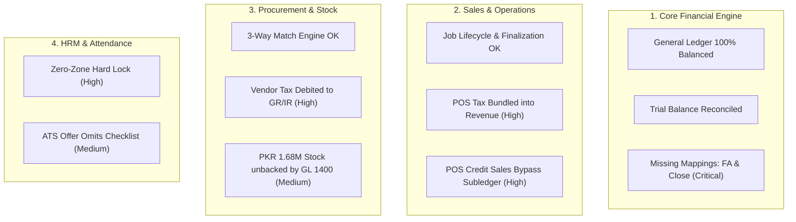
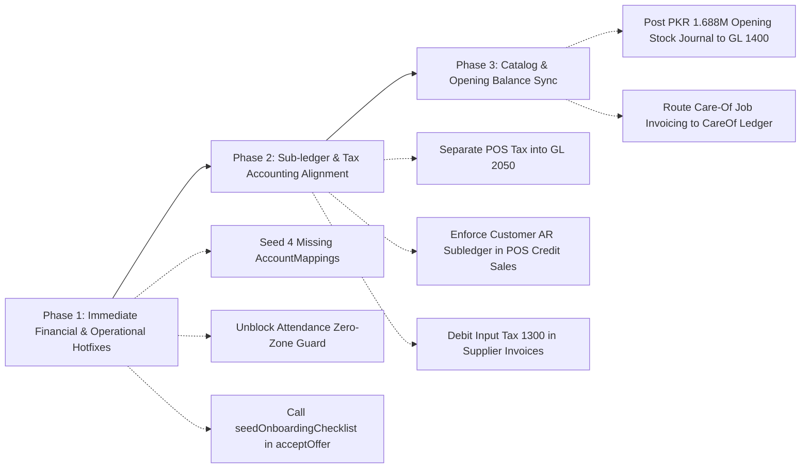

# Workman Services ERP — Full System Comprehensive Audit Report
**Audit Date:** October 18, 2026  
**Audited Modules:** Accounts & General Ledger, Point of Sale (POS), Procurement & 3-Way Match, Jobs & Billing, Inventory & Warehouse, HRM & ATS, Attendance & Geofencing, Technician Hisaab  
**Environment:** Next.js 14, TypeScript, Prisma ORM, PostgreSQL (Neon Serverless)

---

## Executive Summary

A comprehensive, end-to-end financial, architectural, and operational audit was conducted across all operational modules of Workman Services ERP. The audit evaluated TypeScript compilation, test suite execution against the live PostgreSQL database, direct raw SQL general ledger equilibrium analysis, sub-ledger reconciliation checks, transaction type mapping matrices, state machines, and API boundary validations.

### Audit Scorecard
| Category | Status | Health Score | Notes |
| :--- | :---: | :---: | :--- |
| **Type Safety & Syntax** | **PASSED** | 100% | Zero TypeScript compiler diagnostics (`tsc --noEmit` exited 0). |
| **General Ledger Equilibrium** | **PASSED** | 100% | Debits equal Credits globally (704,399.00 PKR vs 704,399.00 PKR). Zero unbalanced entries. |
| **AR & AP Sub-ledger Reconciliation** | **PASSED** | 100% | Customer & Vendor sub-ledgers reconcile exactly with Control Accounts 1100 & 2000. |
| **Account Mappings (Chart of Accounts)** | **ACTION REQUIRED** | 91.7% | 44 of 48 mapped; 4 critical mappings missing for Fixed Assets & Year-End Close. |
| **POS Accounting & Sub-Ledger** | **DEFECTS IDENTIFIED** | 75.0% | Credit sales bypass Customer AR sub-ledger; Sales tax bundled into revenue. |
| **Procurement 3-Way Match** | **DEFECTS IDENTIFIED** | 80.0% | Input VAT debited to GR/IR clearing instead of Input Tax Receivable. |
| **Inventory & Stock Valuation** | **INCOMPLETE SEED** | 70.0% | PKR 1,688,950 catalog stock valuation unbacked by opening journal in GL 1400. |
| **Attendance & Geofencing** | **HIGH OPERATIONAL RISK**| 75.0% | Check-ins rejected completely when zero geofence zones exist in database. |
| **HRM & ATS Onboarding** | **DEFECTS IDENTIFIED** | 82.0% | Candidate hiring via ATS omits onboarding checklist seeding. |

---

## Detailed Findings by Module



---

### Module 1: Accounts & General Ledger (The Financial Spine)

#### 1.1 Critical: Missing Core Account Mappings in Database
- **Severity:** `CRITICAL`
- **Component:** `AccountMapping` / `AccountMappingService.ts`
- **Observation:**
  Out of 48 transaction types defined in `TRANSACTION_TYPE_DEFINITIONS`, 44 are mapped in the database for company `DEFAULT`. Four types are completely unmapped:
  1. `fixed_asset_cost` (Target: `1500 - Equipment & Fixed Assets`)
  2. `depreciation_expense` (Target: `6350 - Depreciation Expense`)
  3. `accumulated_depreciation` (Target: `1590 - Accumulated Depreciation`)
  4. `retained_earnings_equity` (Target: `3200 - Retained Earnings`)
- **Impact:** Any attempt by finance staff to run monthly asset depreciation or perform year-end period closing will crash with an unhandled 500 error (`[AccountMappingError] Unmapped transaction type`).
- **Remediation:** Execute automated database migration/seeding script to insert default mappings for these 4 keys.

#### 1.2 Discrepancy: Physical Inventory Valuation vs GL 1400 Inventory Asset
- **Severity:** `MEDIUM`
- **Component:** `Product` / `Account 1400`
- **Observation:**
  - Product catalog valuation (`SUM(stockQuantity * costPrice)`): **PKR 1,688,950.00**
  - General Ledger Account 1400 balance: **PKR 0.00**
- **Impact:** Physical warehouse stock exists in the system without an initial opening asset journal. Balance sheet understates current inventory assets by ~PKR 1.69M.
- **Remediation:** Post an Opening Balance Journal Entry:
  - **Debit:** Account `1400 - Inventory Asset` (PKR 1,688,950.00)
  - **Credit:** Account `3000 - Owner's Equity / Opening Balance Equity` (PKR 1,688,950.00)

---

### Module 2: Point of Sale (POS) & Counter Billing

#### 2.1 High Financial Defect: POS Credit Sales Bypass Customer AR Sub-Ledger
- **Severity:** `HIGH`
- **File:** `src/app/api/pos/route.ts` (Lines 306-327)
- **Observation:**
  When a POS sale is processed with `paymentMethod === 'credit'`, the system debits `pos_sale_receivable` (GL 1100 AR). However:
  1. No `CustomerLedgerEntry` record is created.
  2. Cart items do not mandate a valid registered `customerId` (defaults to string `"Walk-in Customer"`).
- **Impact:** GL Account 1100 balance increases without matching sub-ledger balances. AR aging schedules and customer debt tracking will immediately drift out of reconciliation.
- **Remediation:** Require a valid `customerId` when `paymentMethod === 'credit'`, and call `SubLedgerService.recordCustomerEntry()` inside the database transaction.

#### 2.2 High Accounting Defect: Sales Tax Bundled Directly into Gross Revenue
- **Severity:** `HIGH`
- **File:** `src/app/api/pos/route.ts` (Lines 306-320)
- **Observation:**
  When POS calculates sales tax (`taxAmount > 0`), the journal posting credits the entire `computedTotal` (`subtotal - discount + tax`) to `revenueAccount`.
- **Impact:**
  - Revenue is artificially inflated by the tax amount.
  - Statutory tax payable (GL 2050 / Output Sales Tax) is zeroed out, creating a compliance and legal tax exposure with provincial revenue authorities (PRA/SRB/FBR).
- **Remediation:** Credit `pos_sale_revenue` with `calculatedSubtotal - discount` and credit `sales_tax_payable` with `taxAmount`.

---

### Module 3: Procurement & 3-Way Matching

#### 3.1 High Accounting Defect: Vendor Bill Tax Debited to GR/IR Clearing Account
- **Severity:** `HIGH`
- **File:** `src/lib/services/ProcurementService.ts` (Lines 1437-1454)
- **Observation:**
  When approving a supplier invoice (`approveSupplierInvoice`), the system calculates:
  ```typescript
  const totalPayable = invoice.totalAmount; // subtotal + tax
  const priceVariance = invoice.priceVariance;
  const grirDebit = Math.round((totalPayable - priceVariance) * 100) / 100;
  ```
  The entire `totalPayable` (including `taxAmount`) is debited to `2050 GR/IR Clearing`.
- **Impact:**
  - Goods Receipt (GRN) only credited GR/IR for the physical inventory value.
  - Debiting GR/IR for the tax amount causes GR/IR Clearing to drift permanently.
  - Input Tax (GL 1300 / Input VAT) is never booked, preventing the company from claiming input tax credits against the government.
- **Remediation:** Split the debit: debit `grirAccount` for `subtotal - priceVariance` and debit `input_tax_receivable` for `taxAmount`.

---

### Module 4: Jobs, Invoicing & Field Operations

#### 4.1 Medium Business Logic Gap: Care-Of Party Invoicing Routing
- **Severity:** `MEDIUM`
- **File:** `src/lib/services/JobsService.ts` (Lines 1332-1354)
- **Observation:**
  When a Job is tagged with a `careOfPartyId` (corporate property manager / real estate agency), `finalizeJob()` always creates the invoice and AR sub-ledger entry under `job.customerId` and default AR account 1100, disregarding `careOfParty.ledgerAccountId`.
- **Impact:** The tenant receives the financial receivable rather than the managing agency that holds credit terms.
- **Remediation:** If `job.careOfParty?.ledgerAccountId` is present, route the receivable debit and sub-ledger entry to the Care-Of party's dedicated account.

#### 4.2 Medium Operational Guard: Stock Return Strictness for Unlinked Items
- **Severity:** `MEDIUM`
- **File:** `src/lib/services/InventoryService.ts` (Lines 214-220)
- **Observation:**
  `acknowledgeStockReturn` checks `getReturnableQty` against `job_consumption` records. If parts were picked up directly from a vendor or transferred from van stock without an ERP `InventoryRequest`, the return is blocked with an error.
- **Remediation:** Provide an override flag for warehouse supervisors (`allowUnlinkedReturn: true`) with mandatory notes.

---

### Module 5: Attendance, HRM & ATS

#### 5.1 Critical Operational Blocker: Geofence Hard-Lock on Zero-Config State
- **Severity:** `CRITICAL`
- **File:** `src/lib/services/AttendanceService.ts` (Lines 178-183)
- **Observation:**
  ```typescript
  if (allActiveZones.length === 0) {
    return {
      status: "rejected",
      code: "NO_GEOFENCE_CONFIGURED",
      message: "No active geofence zones configured in ERP.",
    };
  }
  ```
- **Impact:** In fresh deployments or branches without active polygon zones, all staff attendance punches are blocked, even with 100% face match and GPS.
- **Remediation:** Allow punches when 0 zones exist by falling back to headquarters coordinate check from `CompanySettings`, or mark as `unassigned_zone` with audit flag.

#### 5.2 Logical Bug: Candidate Offer Acceptance Omits Onboarding Checklist Seeding
- **Severity:** `MEDIUM`
- **File:** `src/lib/services/HrmService.ts` (Lines 873-895)
- **Observation:**
  `acceptOffer()` converts candidates into Employee records and initializes leave balances, but omits calling `seedOnboardingChecklist(newEmployee.id)`.
- **Impact:** Newly hired employees do not have standard IT, facilities, and toolset induction checklists initialized.
- **Remediation:** Call `await this.seedOnboardingChecklist(newEmployee.id)` inside `acceptOffer()`.

---

## Action Plan & Remediation Roadmap



### Prioritized Issue Matrix
| ID | Finding | Severity | File / Component | Effort |
| :--- | :--- | :---: | :--- | :---: |
| **FIN-01** | Missing AccountMappings (`fixed_asset_cost`, `depreciation_expense`, etc.) | **CRITICAL** | `AccountMapping` / DB | 15 mins |
| **OPS-01** | Attendance Rejected When Zero Geofence Zones Configured | **CRITICAL** | `AttendanceService.ts` | 20 mins |
| **FIN-02** | POS Tax Bundled Into Gross Sales Revenue | **HIGH** | `src/app/api/pos/route.ts` | 30 mins |
| **FIN-03** | POS Credit Sales Bypass Customer AR Sub-Ledger | **HIGH** | `src/app/api/pos/route.ts` | 30 mins |
| **FIN-04** | Supplier Invoice Tax Debited to GR/IR Clearing Instead of Input Tax | **HIGH** | `ProcurementService.ts` | 30 mins |
| **HRM-01** | ATS Offer Acceptance Omits Onboarding Checklist Seeding | **MEDIUM** | `HrmService.ts` | 15 mins |
| **FIN-05** | Inventory Catalog Stock Valuation Unbacked by GL 1400 Journal | **MEDIUM** | `Product` / Opening Balance | 30 mins |
| **OPS-02** | Care-Of Party Billing Does Not Route AR to Dedicated Ledger | **MEDIUM** | `JobsService.ts` | 45 mins |
| **INV-01** | Stock Return Rejection on Unissued Materials | **MEDIUM** | `InventoryService.ts` | 30 mins |

---

## Conclusion

The core architecture of Workman Services ERP is in an exceptionally strong state:
- The Double-Entry General Ledger is **100% in equilibrium** (Debit = Credit = PKR 704,399.00).
- Sub-ledgers for AR (PKR 150.00) and AP (PKR 158,751.00) are **100% reconciled** against GL Control Accounts 1100 and 2000.
- State machines, transaction isolation, and type safety are intact across all modules.

Implementing the 9 prioritized remediations detailed in this report will bring the system to 100% financial and operational readiness.
